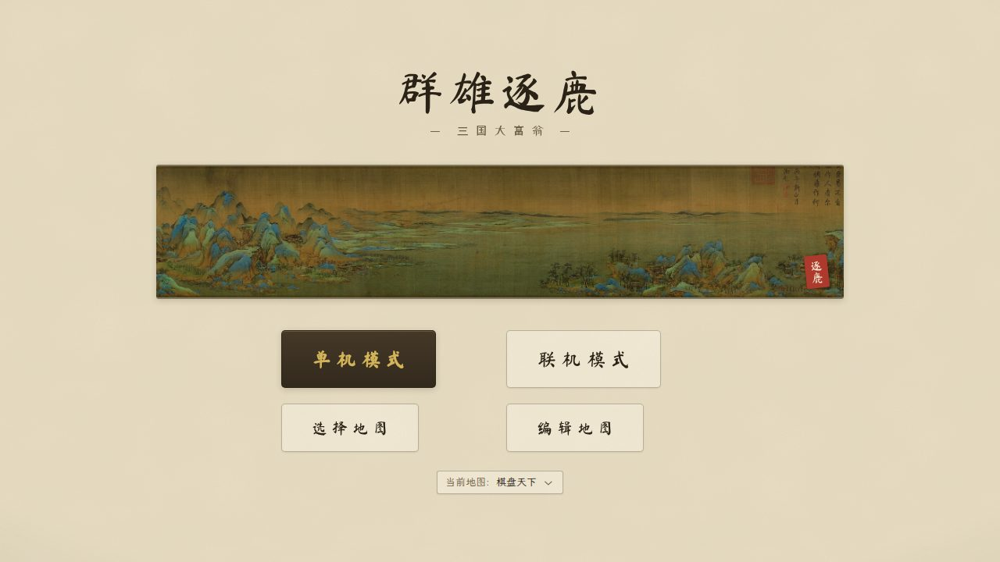
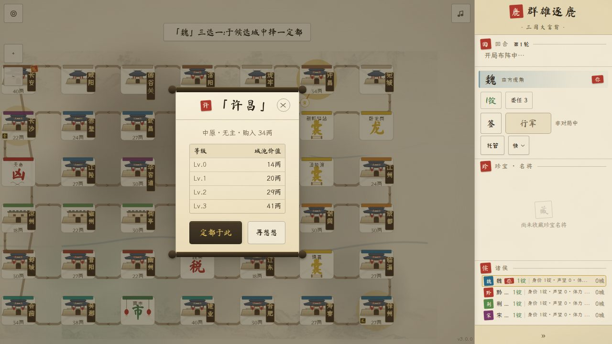
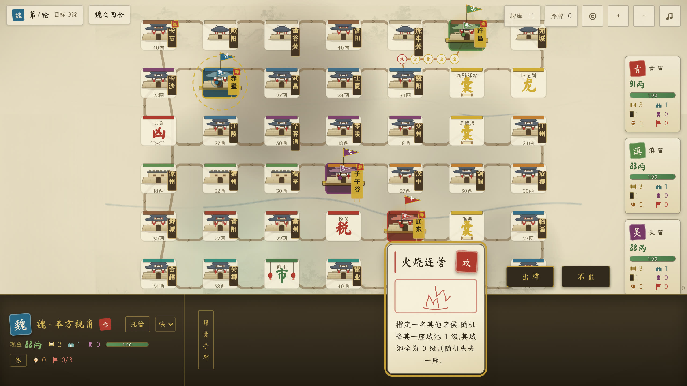

# 新手第一局:从起兵到称帝

> 本文带你走完第一局**单机对局**。你执一国，对手是电脑。

买城可以每轮收银，守住城才能继续收。攻城打掉敌人的防御可得银，攻陷后还可能接手城池。你的目标是把现金攒到称帝所需的数目。

## 开一局单机

打开手机上装好的 **「群雄逐鹿」**,首页四个入口里点 **「单机模式」**。

## 起兵:立国号、定诸侯

准备页左侧配置对局，右侧填写国号、确认座次。

- **诸侯数**默认 4。第 1 席是你，其余全是电脑。首局想快可减到 2。
- **目标身价**有「速战」「标准」「鏖战」三档。首局选「速战」，金额见准备页。
- **机遇(落格触发事件)**:一个折叠区,保持默认即可,不用展开。
- **国号**填一个汉字，或打开「字盘」点选一个。起兵成功后会记住，下次自动带入。
- 其余座位不用管,电脑的国号开局时自动分配。

点 **「起兵」**,按钮短暂变成「调兵遣将中…」,随后进入棋盘。

## 国号与点将:你不用动手的两步

进入棋盘后不用动手:系统自动完成登记国号、全员掷骰排定**选都顺序**(这一步叫**点将**),随后按名次轮流选都。开局流程全貌详见 [02-开局](../reference/rules/02-开局.md)。

## 三选一选都

轮到你时:

- **你会看到**:地图上三座候选城亮起金圈,顶部横幅提示「轮到你定都:点选一座候选城(余 N 人未定)」。
- **你该点什么**:点一座候选城,弹出这座城的详情卷轴,确认就点 **「定都于此」**;想换一座,点 **「再想想」** 回去重挑。

怎么挑?三座候选天生一档便宜、一档中档、一档昂贵,卷轴里的「购入」价可当参考——首局图省事就挑最便宜的:定都实际花的是**建城费**(另一档价,细则见 [02-开局](../reference/rules/02-开局.md)),钱少花一点,现金就多一点。这座城从此是你的**都城**:行军起点,兼钱袋子——每圈路过都有补给进账(见 [04-地产经济](../reference/rules/04-地产经济.md))。选完都,对局正式开始。

## 前三个回合,照着走

### 第 1 回合：掷骰行军，落城买地

- **你会看到**:右缘席位条上人人一格——现金、体力与各项计数一目了然(自己的格带金边),底缘手牌区左端一枚「签」章驻留掷骰点数;轮到你时,棋盘上先钤一方「签」印起签,随后**自动掷骰**——看一段掷骰动画,棋子自己前进点数那么多格,不用点任何按钮。
- **你该点什么**:什么都不用点,看棋子走。若一进来底部手牌架的牌**金边上浮**(出牌阶段:起手发的那张锦囊在问你用不用),首局建议点 **「不出」**,放行后自动开走。

落定之后看落点,最常遇到:

| 落到哪                 | 你会看到                                 | 你该点什么                                                                        |
| ---------------------- | ---------------------------------------- | --------------------------------------------------------------------------------- |
| 无主城                 | 「购地抉择」卷轴:购入价与每轮收益        | 想买点 **「购地」**(花银两);不买点 **「不取」**                                   |
| 自己的城               | 「扩军抉择」卷轴                         | 点 **「扩军(免费)」** 白赚 1 级,或点「按兵不动」                                  |
| 锦囊城(泸水/南徐)      | 抽一张锦囊牌                             | 不用点;屏幕底部**手牌架**多出一张牌面                                             |
| 路过自己都城(绕一圈后) | 行军半路被迫停下,领驻跸补给,回合就此结束 | 不用点,这是「必停」规矩;详见 [03-回合与行军](../reference/rules/03-回合与行军.md) |

买地前看卷轴里的「每轮收益」和购入后剩下的现金。全桌行动一轮后，仍由你持有的非都城会为你收银。详见[持城收益](../reference/rules/04-地产经济.md#持城收益)。

没弹卷轴就是无事发生。另外两点:普通城每次落格必先弹一条「机遇」卷轴(机遇必出,不掷概率;落在好运/中性/霉运哪一档才看声望)——读文案、挑一条即可,详见 [07-声望与机遇](../reference/rules/07-声望与机遇.md);若弹出「招贤纳士」卷轴(比如路过卧龙岗),点一位名将收下即可,详见 [08-名将与技能](../reference/rules/08-名将与技能.md)。等你走完,电脑接手其余玩家——此刻谁在行动,看右缘席位格上的金圈呼吸指名。全部落格种类详见 [03-回合与行军](../reference/rules/03-回合与行军.md)。

进了手牌的锦囊随时能查:**点一下手牌架上的牌**(或长按)弹出详情,全文、标签、目标一屏读完,点关闭钮或弹层外关闭。手牌是暗置的——只有你能看自己的,别人界面上只有一个计数。

### 第 2 回合：用锦囊攻城

新回合一开始,手里的锦囊会先「问」你一轮(每回合都问,直到你用掉)——不弹窗,手牌架就地进入**出牌阶段**:

- **可用的牌**会在手牌架金边上浮。若已招到名将，他就绪的主动技也会在架里显示为技能卡。点卡面技名可以查看他学过哪些技能。
- **点牌读全文**。需要目标时点 **「选目标」**，再点棋盘城池或右缘的诸侯席位选中目标。点 **「出牌」** 使用锦囊，点 **「发动」** 使用技能。想留着则在选牌时点 **「不出」**。

抽到「火烧连营」时，先看目标城名下的等级徽记和蓝盾。徽记写等级，蓝盾写剩余防御。火势会波及前方城池，每实际打掉敌城 1 点防御就领 5 两。火焰命中后没打空本级防御，城池会燃烧。每过三个实际回合，火焰图标填满并消耗 1 个标记，扣 1 点防御。点城可查火焰的伤害来源与伤害排行榜。

打空 1 级非都城便是攻陷。累计伤害最高的存活诸侯接城，参与进攻的存活诸侯按伤害分银，打中最后一点防御的进攻者另领攻陷奖励。详见[城池攻陷与奖励](../reference/rules/04-地产经济.md#城池攻陷与奖励)与[锦囊](../reference/rules/06-锦囊.md)。

### 第 3 回合:落进别人的城,珍宝交涉

落在他人城,且城主手里有珍宝时:

- **你会看到**:「珍宝抉择」卷轴,「魏 落『许昌』。蜀 有 2 件珍宝,正在权衡是否出售…」这样的文案。
- **你该点什么**:基本不用点——**决定权在城主**(此刻是电脑)。他决定卖,你就按价掏钱,不能拒买;现金不够会被先逼着变卖家产抵账(详见 [09-破产清算](../reference/rules/09-破产清算.md))。不想干等,点右上 × 收起卷轴。

反过来,电脑落到**你的**城时,由你开价,三选一:**暂不交易**(无事发生)/ **公道买卖**(按指导价卖给他,钱进你口袋,你的城还 +1 级)/ **坐地起价**(加价卖,城不升级)。交涉细则详见 [05-珍宝](../reference/rules/05-珍宝.md)。

### 守城：用反应窗挡下敌招

走棋途中,电脑出锦囊、或行军将过你的城时,你未必只能看戏:

- **你会看到**:手牌架上方浮出一条横幅——左段一句「魏 使用【火烧连营】」或「魏 行军将过你的城池」,右端一圈朱砂倒计时(约三秒);架上此刻能接招的牌**金边呼吸**。手里没有能接的牌,这横幅永远不会出现——不用管它。
- **你该点什么**:能接招的是识破诡计(拆电脑的锦囊)和半路杀出(拦过路的行人)这类「即时」牌。想接就点牌选中,再点 **「落印」**;横征暴敛这类人人有份的牌,还会先让你点横幅上的国号小笺、选定护谁(可以是自己)。不想接就点 **「不用」**,或干脆等倒计时走完——自动当「不用」,不点也不卡局。嫌问得勤,点横幅上的 **「本回合不再询问」**,本回合后续询问自动替你回「不用」。

这类「即时」牌平时不进「出牌阶段」(在架中灰置、印着「唯反应」),只在反应窗登场。细则见 [06-锦囊](../reference/rules/06-锦囊.md)。

你的城遭到火烧连营时，可用「识破诡计」保护受波及的城。若有多座可选，点要守的那座再落印。守住城就能继续领它的每轮收益。

## 怎么赢:把现金攒到目标身价

- **身价只数现金**:城池、珍宝都不算数。右缘席位格上人人一行现金主数(自己的格带金边)——它就是身价,随时可查。
- 每次经过或落到自己都城可领固定补给。全桌轮末，非都城按当时归属发持城收益。卖珍宝和攻打敌城也能得银。
- 回合效果和发银全部结清后，现金达标者中余额最高的人称帝。最高现金并列就拼点。若对手尽数破产，你也能直接称帝。点 **「再战一局」** 回主页，可从「对局诊断」保存刚才这一局的记录。

两种胜利方式与身价原理详见 [01-总览与胜利](../reference/rules/01-总览与胜利.md)。

## 卡住了怎么办

- **掷骰还没发生**:轮到你时先等「起签」一拍(约两秒内自动开走);若迟迟不动,多半是还有决策等你处理(购地/机遇等卷轴,或手牌架进入出牌阶段),作答即继续。
- **选错了**:别慌,几乎没有一步选错就万劫不复的决策;真欠了债也有变卖自救的流程(见 [09-破产清算](../reference/rules/09-破产清算.md))。
- **要暂离**:点 ⚙ 开**设置弹层**,拨 **「托管」** 开关让电脑代打;回来再把开关拨回,控制就回到你手上。想查诸侯们的现金/城池/声望,点 ☰ 开**诸侯详情**,再点行里的城池/名将/珍宝/声望可钻进去看明细。
- 下一步想和朋友各带一台设备对战:见[联机对战](../how-to/联机对战.md)。

## 想深入了解(可选)

- 规则手册全十页:[docs/reference/rules/](../reference/rules/README.md)
- 玩家用词与内部术语的对照表:[GLOSSARY.md](../../GLOSSARY.md)
