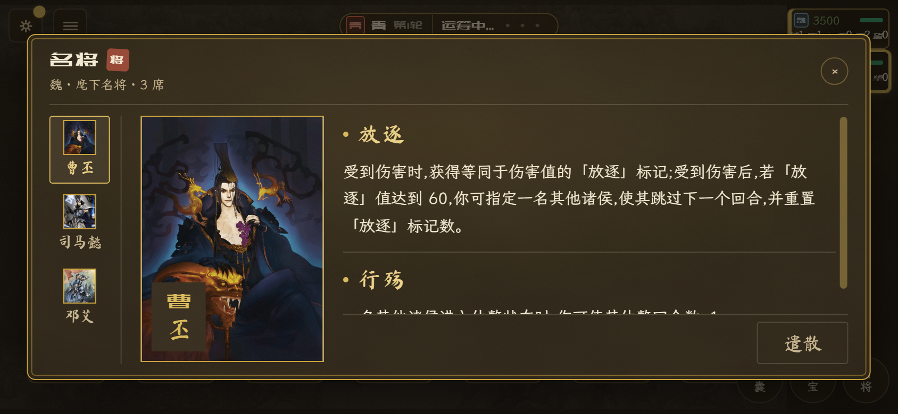
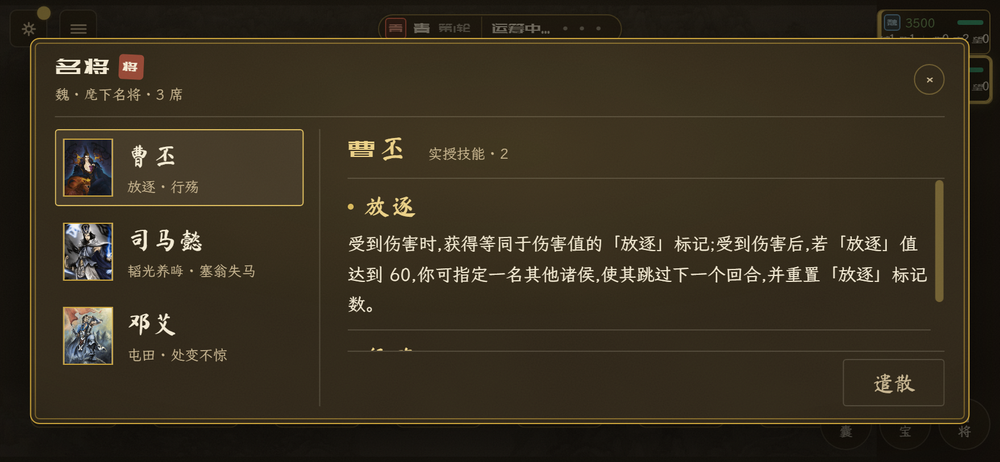
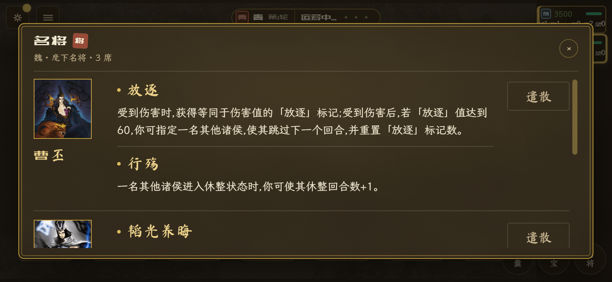
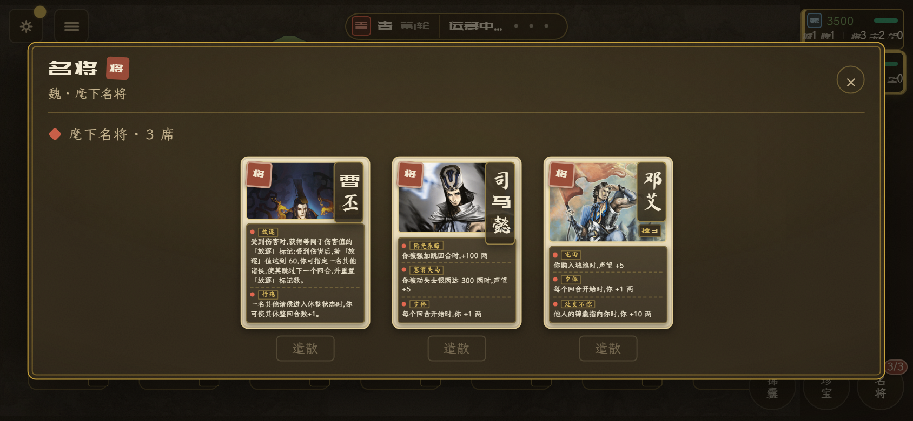
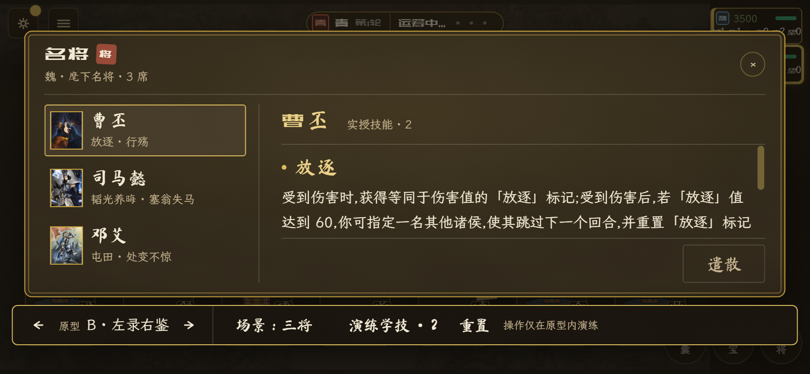
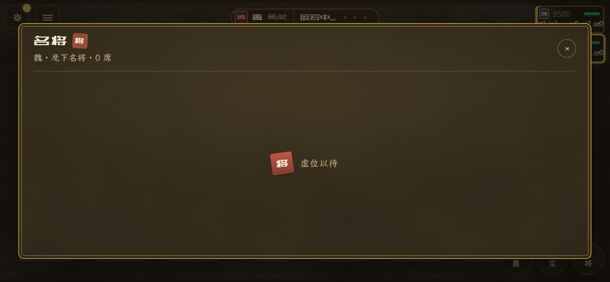
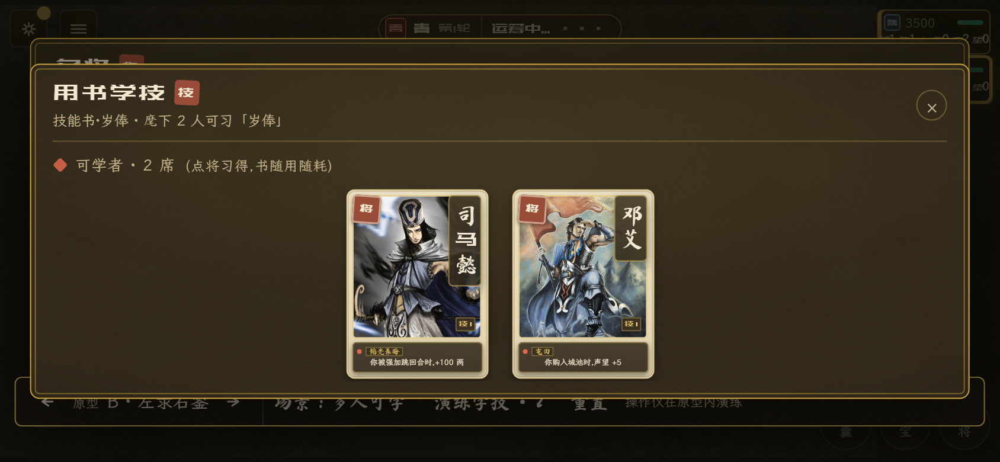

# 名将检视三案原型

关联[名将检视的人物与技能阅读布局](https://github.com/openaddr/dafung-web/issues/1400)，属于[剩余17项视觉交互优化决策地图](https://github.com/openaddr/dafung-web/issues/1397)。

**状态：三案待用户选择，尚无设计定案。** 原型只保存在 `codex/prototype/hero-inspect-1400` 分支，草稿 PR 用于评样与存档，不合入主线、不出正式 APK。

## 本次要回答的问题

在手机横屏上，人物身份、实授技能全文和遣散入口如何分配空间，才能读清名将并找到当前可用操作？比较三种阅读结构，保持当前玄墨鎏金方向、名将与技能目录、画像、Base UI 行为层和现役术语。

代码与事实基线为 `3c22030ddcff41a52b88467b144478f5fade4bd4`，产品版本 `2026.11.52`。本轮重拍确认：当前名将卡在标准横屏仍为 120×160，卡基 8px，技能正文实测 6.56px。卡基不等于正文字号；此前“已经有技能全文”不代表全文读起来足够大。

## 三案

| 方案       | 阅读方式                                   | 得到什么                             | 取舍                                         |
| ---------- | ------------------------------------------ | ------------------------------------ | -------------------------------------------- |
| A 人物卷   | 窄画像签切人，中间大幅人物，右侧技能文稿   | 人物辨识突出，一次专注一名将         | 左侧人物占地较多，跨将比较需要切换           |
| B 左录右鉴 | 左侧名册常驻人物与实授技名，右侧全文和遣散 | 麾下名将始终可见，读文与操作位置稳定 | 图片缩成头像；长技能仍需在右侧内滚           |
| C 技能行册 | 名将画像、全文、遣散逐行排列               | 直接连续阅读并比较，不需先选将       | 一屏看不完全部名将，后排名将及操作随内容滚动 |

A、B 的遣散行固定在当前详情下缘；C 的操作属于对应名将行。三案均保留两次确认，不新增机制。长文本保持完整，内滚是方案的一部分。

### A 人物卷



### B 左录右鉴



### C 技能行册



### 现役对照



## 运行与切换

在本分支工作区执行：

```powershell
bun run proto:heroes
```

打开 `http://localhost:5184/?heroPrototype=1&variant=A`。沿现有单机入口开局，选择都城，点右下「名将」即可看到三案布景。保持地址中的 `heroPrototype=1`；无需在真实对局里招募名将。

- 底部工具条的箭头或键盘左右键切换 A/B/C，URL 的 `variant` 随之更新。
- 点「场景」依次切换三将、单将、长技能、空态、他人只读、非己回合、一人可学、多人可学；也可在地址中指定 `scene=single/long/empty/readonly/offturn/book-single/book-multi`，默认 `trio`。
- 「演练学技」只用于评样：一名可学直接演练，多名可学复用现役选人层，学习后该册书显示已用。真实产品的技能书入口仍在珍宝，不把工具条当成新增产品入口。
- 「重置」恢复当前场景。全部演练仅存内存；关闭重开恢复 URL 指定布景，真实对局不变。
- `present=1` 隐藏工具条，使用完整标准弹层，适合看净样；去掉该参数可回到比选工具。工具条模式为底部评样工具让出空间，三案净样用于判断正式布局。
- 不带 `heroPrototype` 的普通名将入口维持现状。普通生产构建不装入原型组件；仅 `prototype` 模式可运行。



## 布景与证据边界

名将名称、画像、技能名与说明从当前目录读取；授技组合是明确布景，不代表真实随机授技概率。三将场景使用曹丕、司马懿、邓艾，长技能场景包含当前长文「放逐」；学习场景用两将共享的「岁俸」。只显示布景中的实授技能，不把全技能池误当已学会。

他人只读场景不显示遣散；非己回合保留禁用操作及原因。空态沿现役「虚位以待」。学技选人层继续复用现役卡面，用于验证通路与选中对象；该层的文字排法尚未跟随三案重绘，评样后需确认是否与选定检视布局一并收口。遣散仅演练二次确认和移出名册，不复刻引擎折书、战报等结算。





截图均为真实浏览器的 844×390 视口、设备像素比 2，使用 `scripts/shot.mjs` 起服和截图。几何、实授文案、按钮状态、基线测量与小范围交互检查记录在 [evidence.json](./evidence.json)。其他场景截图保存在工作区 `tmp/ui-shots/hero-inspect-1400/`，不作为已选方案或正式验收结论。

复拍：先构建专用模式，再运行场景脚本。

```powershell
bun run typecheck
bun run --bun vite build --mode prototype
node proto/hero-inspect-1400/capture.mjs
```

场景脚本自动关闭自己创建的浏览器与预览服务器。评样用开发服务器单独运行，在用户完成选择后由本会话停止并清理工作区；原型分支和认可证据保留。

## 本轮验证

- lint、类型检查、普通生产构建和现有单测通过；未新增正式测试用例。
- 浏览器检查覆盖三案的单将、多将、长技能、空态、他人只读、非己回合，名将切换、URL 与键盘切案、长文滚动、首点确认与再点遣散、单人直接学技、多人选人及学习后的状态；演练后真实对局名将仍为空。
- 三案正文 15px，完整说明可在各自正文区滚动到达；原型工具档的名册与遣散钮也有容器内几何核对。没有横向整页溢出、破图或页面异常。
- 首轮原型发现工具条被正文裁住和键盘切案不稳定，已修正工具条挂载位置与按键处理；后续发现工具档名册挤压详情操作，已压缩该档名册并定向复验。记录不冒充首次全绿。
- 安卓 WebView 真机阅读、触控滑动与返回尚未验证；产品实现后接入[既有真机清单](https://github.com/openaddr/dafung-web/issues/215)。

## 用户选择后再收口

记录玩家目标、选定结构及否决理由、认可样张、关键状态、可观察验收和验证分工，再关闭本张决策票并在地图登记。当前三案只是比选输入，字号、间距与操作形制仍待用户确认；原型代码不直接升格为正式产品。

本项不改招募、授技、技能书、遣散规则，不恢复名将称号；其余优化项继续保留。正式施工后续经规格与实施票承接。
