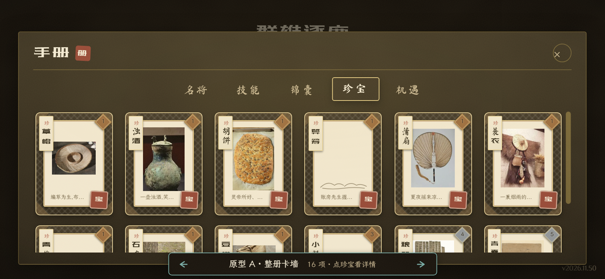
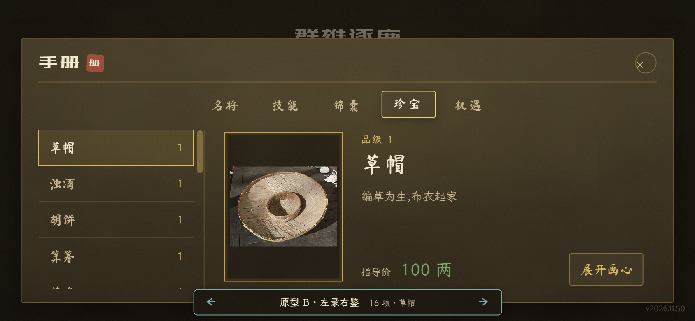
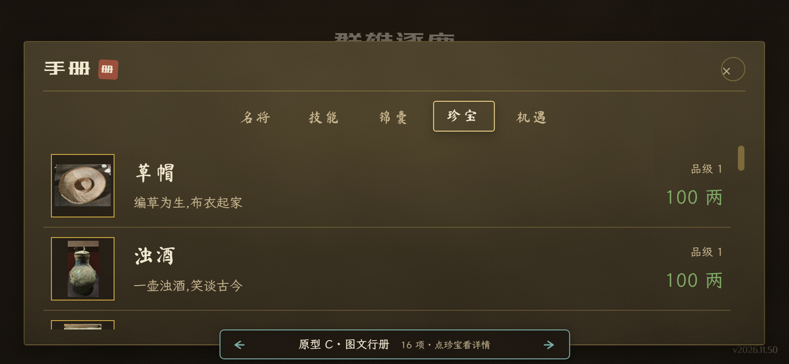

# 珍宝手册三案原型

关联 [原型票 #1399](https://github.com/openaddr/dafung-web/issues/1399) 与 [完整决策地图 #1397](https://github.com/openaddr/dafung-web/issues/1397)。待玩家看过样张后选择，尚无定案；本分支不合入主线。

要回答的问题：横屏手册如何让玩家找到珍宝，并读清名称、品级、说明与价格？三案沿用真实目录、现役卡框、字体及画心素材，暂不决定画材美术。

在本分支安装依赖后，一条命令启动：

```powershell
bun run dev -- --host 127.0.0.1 --port 5487
```

打开 `http://127.0.0.1:5487/?prototype=treasure-wall&variant=A`，进入「手册 → 珍宝」。底部箭头或键盘左右键切换，URL 中 A/B/C 可复现各案；普通入口不启用原型，正式构建禁用原型入口。

| 方案       | 主要好处                           | 取舍                           |
| ---------- | ---------------------------------- | ------------------------------ |
| A 整册卡墙 | 同屏扫视较多器物，保留现役竖卡形制 | 小字需要进入详情阅读           |
| B 左录右鉴 | 目录选项与大图、全文、价格同屏     | 一次重点阅读一件，比较需切换   |
| C 图文行册 | 名称、全文与价格直接逐行比较       | 单屏展示项较少，卡牌装裱感减弱 |

样张按 844×390、设备像素比 2 实拍：







浏览器已验证箭头切换、URL 更新、键盘切换、选中与无画心条目、既有详情打开和关闭，以及普通入口不出现原型。样张用于讨论结构，正式方案仍需确认可观察的验收条件；安卓真机触感尚未验收。
